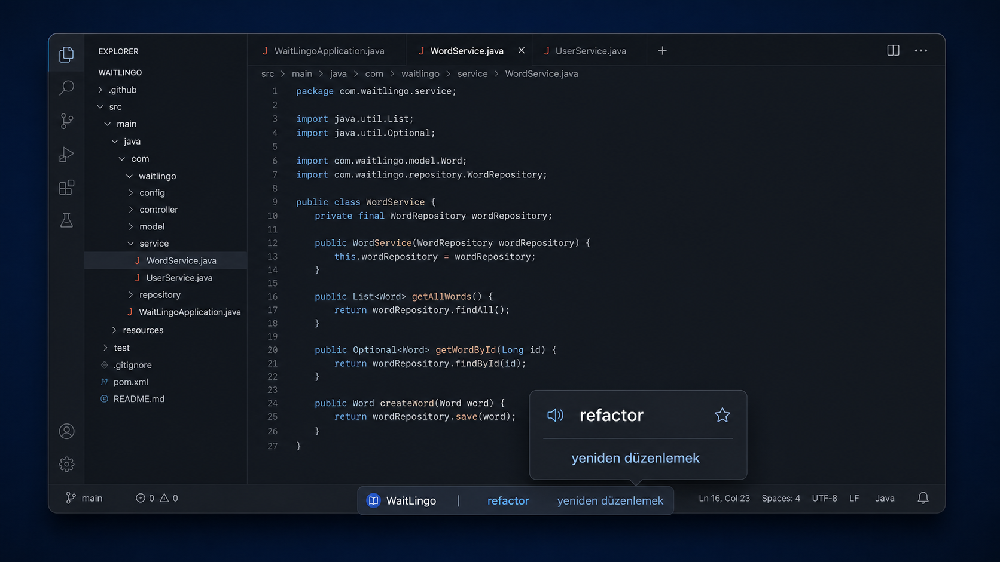
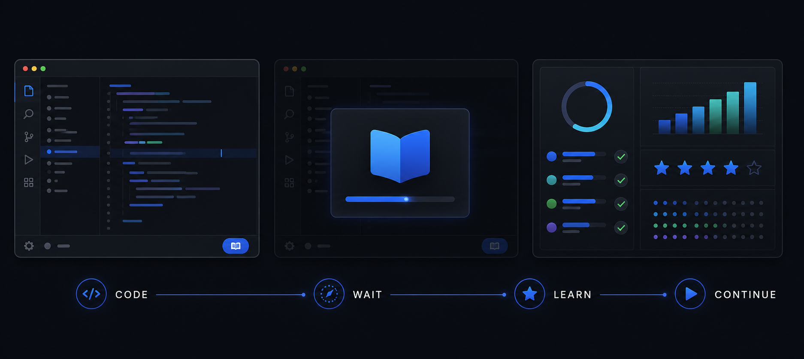

<div align="center">


# WaitLingo

### Learn developer English without leaving your coding flow.

WaitLingo turns the quiet moments inside your JetBrains IDE into calm, effortless language practice — one useful word or phrase at a time.

[](#installation)
[](#build-from-source)
[](#private-by-design)
[](LICENSE)

</div>



## Your IDE already has waiting moments

Builds run. Tests start. The IDE indexes. You pause for a second before the next change.

WaitLingo gently uses those moments to show a short English–Turkish word or developer phrase in the status bar. There is no lesson to launch, no browser tab to open, and no streak screen demanding your attention.

**Glance at it. Learn something useful. Keep coding.**



## Designed around your flow

| While you are… | WaitLingo quietly… |
|---|---|
| Writing code | Slows down so it does not compete for your attention |
| Building or indexing | Uses the waiting moment to surface another useful phrase |
| Working in a test file | Prioritizes testing vocabulary |
| Editing backend or build files | Favors API, architecture, database, and DevOps language |
| Hovering over the card | Reveals the meaning and a short example after a gentle delay |
| Presenting or debugging | Switches to a more compact, calmer appearance |

## A few seconds are enough

The status bar card gives you the word and meaning at a glance. Click only when you want a little more context:

- **Again soon** — bring this word back after a short interval.
- **Next** — move on without changing its learning state.
- **Got it** — schedule it further into the future.
- **★ Favorite** — keep useful or difficult words close.
- **🔊 Pronounce** — hear the word through your operating system's offline voice.

Right-click the card to pin a word, hide it for today, snooze WaitLingo for 30 minutes, favorite it, or move to the next word instantly.

## English that developers actually use

WaitLingo includes general vocabulary as well as practical phrases you can use in tickets, pull requests, reviews, and technical conversations:

```text
handle an edge case       → uç bir durumu ele almak
reproduce the issue       → sorunu yeniden oluşturmak
resolve a conflict        → çakışmayı çözmek
validate the payload      → istek verisini doğrulamak
roll back the release     → sürümü geri almak
cover with tests          → testlerle kapsamak
```

Choose the content that matches your work:

- Git & Code Review
- Backend & API
- Testing
- DevOps
- Database
- Frontend

## Learns what to show — locally

WaitLingo uses the active file and class name to prioritize relevant vocabulary. A test file can surface phrases such as `mock the dependency`; a build file can bring forward `check the build logs`.

Its lightweight spaced-repetition logic remembers what you marked as understood or difficult. A recurring **word of the day** reinforces one item throughout the day without turning your IDE into a classroom.

Everything stays on your machine.

## Make it yours

Open **Settings → Tools → WaitLingo** to choose:

- English → Turkish or Turkish → English
- CEFR levels
- Technical content pack and topic tags
- Rotation speed
- Compact mode
- Adaptive rotation
- Status bar font size
- Optional progress notifications
- Your own CSV or JSON vocabulary file

Open the **WaitLingo Tool Window** whenever you want to search the vocabulary, revisit favorites, or see a quiet daily and weekly summary.

## Useful shortcuts

| Action | Shortcut / location |
|---|---|
| Show another word | `Ctrl + Alt + W` |
| Open details | Click the status bar card |
| Quick actions | Right-click the status bar card |
| Browse vocabulary and progress | WaitLingo Tool Window |
| Personalize WaitLingo | Settings → Tools → WaitLingo |

## Bring your own vocabulary

WaitLingo can load a personal UTF-8 JSON file or a simple CSV file:

```csv
word,translation,example,category,level,tags
idempotent,tekrarlandığında sonucu değişmeyen,The endpoint is idempotent.,developer,B2,api|architecture
```

This is useful for team terminology, interview preparation, unfamiliar project language, or words you keep meeting in documentation.

## Private by design

WaitLingo is fully offline.

- No account
- No telemetry
- No analytics
- No network requests
- No vocabulary or progress data leaving your IDE

Settings and learning progress are stored locally through the IntelliJ Platform settings system.

## Installation

### Install from disk

1. Download or build the plugin ZIP.
2. Open **Settings → Plugins** in your JetBrains IDE.
3. Select the gear icon.
4. Choose **Install Plugin from Disk…**
5. Select the WaitLingo ZIP and restart the IDE if requested.

The generated development package is available under `build/distributions`.

## Build from source

Requirements:

- JDK 17 or newer
- IntelliJ IDEA or another compatible JetBrains IDE

```bash
./gradlew clean test buildPlugin verifyPlugin
```

On Windows:

```powershell
gradlew.bat clean test buildPlugin verifyPlugin
```

## Contributing

Code improvements and vocabulary contributions are welcome. See [CONTRIBUTING.md](CONTRIBUTING.md) for the vocabulary schema and validation steps.

## License

WaitLingo is available under the [Apache License 2.0](LICENSE).

<div align="center">

**Stay in flow. Leave each coding session with one more useful phrase.**

</div>
